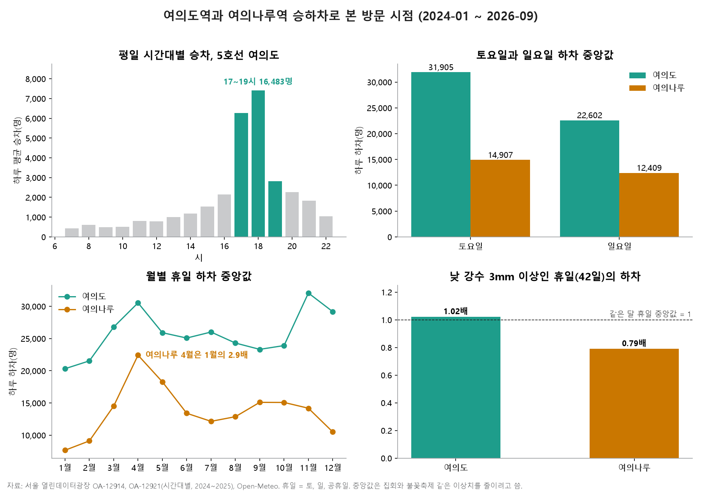

# yeouido-footfall

여의도역과 여의나루역 승하차, 날씨로 더현대 서울 주변에 사람이 언제 모이고 언제 빠지는지 읽은 분석입니다.
공개 데이터만 쓰고, 원자료를 내려받으면 같은 숫자가 다시 나옵니다.



## 30초 안내

| | |
|---|---|
| 질문 | 더현대 서울에 내국인 손님을 더 자주 부르려면 언제, 어디에 힘을 줘야 하나 |
| 근거 숫자 | 평일 17~19시 5호선 여의도 승차 하루 16,483명. 휴일 하차 중앙값은 토요일 31,905명, 일요일 22,602명(29% 적음). 비 온 휴일에 여의나루는 같은 달 휴일의 0.79배로 줄고 여의도는 1.02배로 그대로 |
| 판단 | 퇴근길 평일 저녁, 사람이 덜 오는 일요일, 비 예보가 있는 휴일이 더 부를 여지가 있는 때다. 한강 쪽(여의나루)은 4월에 1월의 2.9배로 늘어 계절 행사와 묶기 좋다 |
| 한계 | 하차 인원은 방문객 수가 아니다. 여의도역 하차에는 직장인과 한강 방문객이 섞여 있다(아래 한계 절) |

## 결과

| 항목 | 숫자 | 읽는 법 |
|---|---|---|
| 하루 평균 하차, 여의도 | 평일 69,397명, 휴일 27,194명 | 평일은 출근 인원이 대부분이라 휴일 숫자가 쇼핑 수요에 더 가깝다 |
| 휴일 하차 중앙값, 여의도 | 토요일 31,905명, 일요일 22,602명 | 일요일이 토요일보다 29% 적다. 세 해 모두 같은 방향 |
| 월별 휴일 하차 중앙값, 여의도 | 1월 20,314명, 4월 30,533명, 11월 32,056명 | 1월이 가장 적고 11월이 가장 많다 |
| 월별 휴일 하차 중앙값, 여의나루 | 1월 7,664명, 4월 22,414명 | 4월이 1월의 2.9배. 한강 나들이 영향이 크다 |
| 비 온 휴일(낮 10~20시 강수 3mm 이상, 42일) | 여의도 1.02배, 여의나루 0.79배 | 같은 달 휴일 중앙값 대비. 비가 오면 한강 쪽은 줄고 실내인 여의도 쪽은 줄지 않는다 |
| 평일 시간대별 승차, 5호선 여의도 | 17시 6,257명, 18시 7,413명, 19시 2,813명 | 17~19시 합계 16,483명이 여의도를 떠난다 |

전체 집계는 [results/summary.txt](results/summary.txt)에 있습니다.

### 일요일 행사의 효과를 재려면 몇 번이 필요한가

일요일 하차는 같은 달 일요일끼리 비교해도 흔들림(로그 표준편차)이 0.105입니다.
유의수준 5%, 검정력 80%로 계산하면 행사 일요일이 하차를 10% 늘렸는지 가리는 데 일요일 10번, 5%면 37번이 필요합니다.
여의나루 대비 비율을 기준으로 쓰면 흔들림이 0.198로 커져 10%에 34번이 필요합니다. 그래서 같은 달 일요일을 기준으로 삼는 편이 낫습니다.

## 데이터

원자료는 저장소에 넣지 않았습니다. 아래에서 받아 `data/raw` 아래에 두면 됩니다.

| 폴더 | 데이터 | 받는 곳 | 이용 조건 |
|---|---|---|---|
| `data/raw/subway_daily/` | 지하철 호선별 역별 승하차 인원, 월별 파일 `CARD_SUBWAY_MONTH_YYYYMM.csv` 33개(2024-01 ~ 2026-09) | [서울 열린데이터광장 OA-12914](https://data.seoul.go.kr/dataList/OA-12914/S/1/datasetView.do) | 공공누리 1유형 |
| `data/raw/subway_hourly/` | 서울교통공사 역별 일별 시간대별 승하차 인원, 2024년과 2025년 파일 | [서울 열린데이터광장 OA-12921](https://data.seoul.go.kr/dataList/OA-12921/F/1/datasetView.do) | 공공누리 3유형(변경금지) |
| `data/raw/weather/` | 서울 시간별 기온, 체감온도, 강수량 | [Open-Meteo Historical Weather API](https://archive-api.open-meteo.com/v1/archive?latitude=37.5665&longitude=126.978&start_date=2024-01-01&end_date=2026-09-30&hourly=temperature_2m,apparent_temperature,precipitation&timezone=Asia%2FSeoul&format=csv) (링크를 열면 CSV가 내려받아짐) | CC BY 4.0 |

OA-12921은 변경금지 조건이라 원자료도, 원자료를 가공한 파일도 올리지 않습니다. 이 저장소에는 코드와 집계 숫자, 그림만 있습니다.

## 다시 돌려 보기

```bash
pip install -r requirements.txt
python -X utf8 src/prepare.py            # data/raw 에서 여의도역, 여의나루역, 날씨만 골라 data/clean 에 저장
python -X utf8 src/analyze.py            # 집계를 출력하고 results/summary.txt 에 저장
python -X utf8 src/charts.py             # assets/summary.png 생성
```

원자료가 다른 폴더에 있으면 `python -X utf8 src/prepare.py <원자료 폴더>`처럼 경로를 넘깁니다.
그림의 한글 글꼴은 Windows의 맑은 고딕을 씁니다.

## 정의

- 휴일: 토요일, 일요일, 평일에 걸린 공휴일(대체공휴일, 선거일, 임시공휴일 포함). 목록은 `src/analyze.py`에 직접 적었습니다. 2026년 노동절(5/1)과 제헌절(7/17)은 인사혁신처 2026-04-29 보도자료 기준입니다.
- 여의도역 하차: 5호선과 9호선을 더한 값. 여의나루역은 5호선만 있습니다.
- 시간대별 숫자: 서울교통공사 자료라 5호선 여의도만 있고 9호선은 없습니다. 2024~2025년 분기별 하루 평균을 다시 평균했습니다.
- 중앙값: 2024-12-07, 12-14 국회 앞 집회와 서울세계불꽃축제(2024-10-05, 2025-09-27, 2026-09-05) 같은 날은 하차가 평소의 몇 배라, 평균 대신 중앙값을 씁니다.

## 한계

- 하차 인원은 방문객 수가 아닙니다. 여의도역 휴일 하차에는 더현대 서울 손님 말고도 IFC몰, 여의도공원, 한강 방문객이 섞여 있습니다. 실제 매장 출입 집계나 주차 입차 기록으로 확인해야 합니다.
- 더현대 서울은 여의도역 3번 출구와 지하로 이어지고, 여의나루역 1번 출구도 가깝습니다. 여의나루를 한강 쪽 비교 대상으로 썼지만 두 역 손님이 완전히 나뉘지는 않습니다.
- 날씨는 Open-Meteo 종로 부근 격자 한 곳의 값입니다. 여의도 국지 날씨와 다를 수 있습니다.
- 비 온 휴일은 42일이라 표본이 작습니다. 0.79배와 1.02배는 방향을 보는 숫자로 씁니다.
- 일요일 필요 횟수는 일요일끼리 독립이라고 가정한 근사 계산입니다.

## 라이선스

코드는 [MIT](LICENSE). 데이터는 위 표의 각 제공처 조건을 따릅니다.
